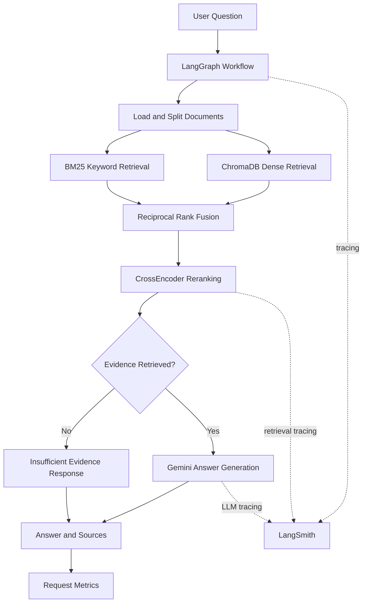

# SentinelAI — Observable RAG Pipeline with Hybrid Retrieval

SentinelAI is a Retrieval-Augmented Generation (RAG) project that answers questions using information retrieved from source documents. It combines semantic search, BM25 keyword retrieval, Reciprocal Rank Fusion (RRF), CrossEncoder reranking, and Google Gemini to generate context-grounded answers.

The project is being developed incrementally, with an emphasis on retrieval quality, workflow orchestration, observability, evaluation, and reliability.

## Project Status

| Stage | Description | Status |
|---|---|---|
| Stage 1 | Core RAG pipeline: ingestion, embeddings, vector storage, hybrid retrieval, reranking, and Gemini answer generation | Completed; core flow developed |
| Stage 2 | LangGraph orchestration, LangSmith tracing, and request-level latency/error monitoring | Completed; validate trace coverage and metrics |
| Stage 3 | FastAPI backend and Streamlit interface | Planned |
| Stage 4 | RAGAS and LLM-as-a-Judge evaluation | Planned |
| Stage 5 | Expanded automated testing and regression tests | Planned |
| Stage 6 | Improved monitoring, documentation, and reliability | Planned |

## Key Features

### 1. Document Ingestion and Chunking
- Loads documents from the local knowledge base.
- Splits text using `RecursiveCharacterTextSplitter`.
- Uses configurable chunk size and overlap.
- Preserves source metadata and chunk positions.
- Validates missing, empty, and invalid document inputs.

### 2. Persistent Vector Storage
- Uses ChromaDB for persistent vector storage.
- Generates embeddings locally using Sentence Transformers.
- Uses `sentence-transformers/all-MiniLM-L6-v2` as the embedding model.
- Stores document chunks with metadata.
- Uses deterministic identifiers and content hashes for document indexing.
- Supports document re-indexing and removal of stale chunks.

### 3. Hybrid Retrieval
Combines two complementary retrieval approaches:

- **Dense retrieval:** Finds semantically similar document chunks using embeddings.
- **Sparse retrieval:** Uses BM25 to find relevant keyword matches.

The two ranked lists are combined using Reciprocal Rank Fusion (RRF).

### 4. CrossEncoder Reranking
A CrossEncoder scores query-document pairs and reranks the retrieved candidates to prioritize relevant passages before generation.

### 5. Grounded Answer Generation
- Uses Google Gemini through LangChain.
- Generates answers using retrieved document context.
- Instructs the model to acknowledge insufficient evidence.
- Treats retrieved document content as untrusted input.
- Returns the answer alongside source information.

### 6. LangGraph Workflow
The RAG pipeline is organized as a LangGraph workflow with:

- A retrieval node.
- Conditional routing based on retrieved evidence.
- An answer-generation node.
- An insufficient-evidence node.

This makes the workflow easier to inspect, extend, and test.

### 7. LangSmith Observability
LangSmith is configured to trace supported LangChain and LLM operations.

Important retrieval operations can also be instrumented to expose individual spans for:
- Dense retrieval.
- BM25 retrieval.
- Reciprocal Rank Fusion.
- CrossEncoder reranking.
- The overall retrieval pipeline.

Trace coverage depends on the implemented instrumentation and should be verified in the LangSmith project.

### 8. Request-Level Monitoring
A lightweight Python monitoring module records:
- Total requests.
- Successful and failed requests.
- Total and average request latency.
- Average number of returned source chunks.
- Error counts by exception type.
- A rolling history of recent requests.

Metrics are currently held in process memory and reset when the application restarts.

---

## Architecture



The diagram shows the logical workflow. LangSmith tracing and request-level metrics serve different purposes: tracing helps inspect individual executions, while monitoring aggregates request outcomes and latency.

## Technology Stack

| Component | Technology | Purpose |
|---|---|---|
| Language | Python | Application logic |
| LLM | Google Gemini (`gemini-3.6-flash`) | Answer generation |
| LLM framework | LangChain | Model integration and document handling |
| Workflow orchestration | LangGraph | RAG workflow and conditional routing |
| Embeddings | Sentence Transformers | Local semantic embeddings |
| Vector database | ChromaDB | Persistent vector storage |
| Keyword retrieval | BM25 | Lexical search |
| Ranking fusion | Reciprocal Rank Fusion | Combines retrieval rankings |
| Reranking | CrossEncoder | Refines document relevance |
| Observability | LangSmith | Tracing and debugging |
| API framework | FastAPI | Planned backend |
| UI framework | Streamlit | Planned user interface |
| Evaluation | RAGAS and LLM-as-a-Judge | Planned answer-quality evaluation |
| Testing | pytest | Planned expanded automated testing |

## Project Structure

Current repository structure:

```text
sentinalAI/
├── .vscode/
├── app/
│   ├── __init__.py
│   ├── graph.py
│   ├── ingestion.py
│   ├── monitoring.py
│   ├── retrieval.py
│   └── vector_store.py
│
├── chroma_db/
├── data/
│   └── sample_docs/
│       └── api_guide.txt
│
├── venv/
├── .env
├── .env.example
├── .gitignore
├── requirements.txt
├── test_chroma.py
├── test_retrieval.py
└── test_vector_store.py
```

The repository folder is currently named `sentinalAI`. Rename it to `sentinel-ai` if you want, but update your terminal path and Git configuration as necessary. The Python package is `app`.

### File Responsibilities

| File | Responsibility |
|---|---|
| `app/graph.py` | Defines the LangGraph workflow and `answer_question()` entry point. |
| `app/ingestion.py` | Loads documents and splits them into chunks. |
| `app/monitoring.py` | Tracks request latency, success/failure counts, and errors. |
| `app/retrieval.py` | Implements dense retrieval, BM25, RRF, caching, and CrossEncoder reranking. |
| `app/vector_store.py` | Configures embeddings and ChromaDB; indexes, searches, and deletes document chunks. |
| `data/sample_docs/api_guide.txt` | Sample API security document used as the knowledge base. |
| `chroma_db/` | Local persisted ChromaDB data. |
| `test_chroma.py` | Standalone ChromaDB checks. |
| `test_retrieval.py` | Standalone retrieval checks. |
| `test_vector_store.py` | Standalone vector-store checks. |
| `.env` | Local credentials and environment settings; never commit this file. |
| `.env.example` | Template showing required environment variables. |
| `requirements.txt` | Python dependencies. |

### Planned Files

The following files do not exist in the current project structure and will be added in later stages:

```text
app/
└── main.py                 # FastAPI application

evaluation/
├── dataset.json            # Evaluation questions and references
├── evaluators.py           # Custom LLM-as-a-Judge evaluators
└── evaluate.py             # Evaluation runner

tests/
└── test_rag.py             # Expanded pytest suite

ui.py                       # Streamlit interface
README.md                   # Project documentation
```

These are planned additions, not existing implementations.

---

## How the RAG Pipeline Works

### Step 1: Load and split documents

`app/ingestion.py` loads the sample API guide and divides it into overlapping chunks.

Current starting configuration:

```python
CHUNK_SIZE = 500
CHUNK_OVERLAP = 50
```

These settings refer to characters rather than exact token counts.

Overlap helps preserve context when a sentence or concept crosses a chunk boundary.

### Step 2: Generate embeddings and index chunks

The local Sentence Transformers model converts each chunk into a vector representation.

ChromaDB stores the vectors, document text, and associated metadata. The persistent index allows the application to retrieve previously indexed content.

### Step 3: Retrieve candidates

Dense retrieval finds semantically similar chunks, while BM25 retrieves chunks using lexical matching.

The BM25 retriever is cached using a corpus fingerprint so it can be reused when the indexed corpus has not changed.

### Step 4: Combine rankings

Reciprocal Rank Fusion combines the dense and sparse rankings.

The RRF scoring formula is:

\[
\operatorname{RRF}(d)=
\sum_{r \in R}
\frac{1}{k_0+\operatorname{rank}_r(d)}
\]

Here, `d` is a document, `R` is the set of rankings, and `k₀` is the smoothing constant.

The current starting configuration uses an RRF constant of `60`.

### Step 5: Rerank candidates

The CrossEncoder evaluates query-document pairs and sorts candidates by relevance.

Current starting configuration:

```python
DENSE_K = 10
SPARSE_K = 10
RERANK_TOP_K = 5
```

These are initial settings, not empirically optimized values. Their impact should be measured during evaluation.

### Step 6: Generate the answer

LangGraph routes the request based on the retrieval result.

- If documents are returned, the workflow passes their content to Gemini for answer generation.
- If no documents are returned, the workflow produces an insufficient-evidence response.

The result contains the question, generated answer, and source information.

A crucial distinction: returning no retrieved documents does not prove that the knowledge base lacks an answer. Retrieval settings and document coverage affect this decision.

---

## Prerequisites

- Python installed and available through PowerShell.
- Git, if cloning the repository.
- A Google AI API key for Gemini.
- A LangSmith API key for authenticated tracing.
- Internet access for Gemini API requests and initial model downloads.

The development environment has used Python 3.13. If a dependency fails to install, check its supported Python versions and use a compatible environment.

## Installation and Setup

The following commands assume Windows PowerShell and that you are working from the project root.

### 1. Navigate to the project

If the repository already exists locally, open its directory in the terminal.

For example:

```powershell
cd "D:\path\to\sentinalAI"
```

Replace the example path with your actual project path.

### 2. Create and activate a virtual environment

If you already have a working `venv`, you can reuse it.

To create a new environment:

```powershell
py -m venv venv
.\venv\Scripts\Activate.ps1
```

If PowerShell blocks script activation, use an approved alternative terminal or follow your organization's execution-policy guidance.

### 3. Install dependencies

```powershell
python -m pip install --upgrade pip
pip install -r requirements.txt
```

The core dependency set includes the packages used for the current pipeline:

```text
langgraph
langchain-core
langchain-google-genai
langchain-text-splitters
langchain-chroma
chromadb
langchain-huggingface
sentence-transformers
langchain-community
rank-bm25
langsmith
python-dotenv
```

FastAPI, Uvicorn, Streamlit, pytest, and evaluation dependencies can be added as their respective stages are implemented.

Keep `requirements.txt` aligned with the packages actually used and pin compatible versions after verifying the environment.

### 4. Configure environment variables

Create or update `.env` in the project root:

```dotenv
GOOGLE_API_KEY=your_google_api_key
LANGSMITH_API_KEY=your_langsmith_api_key
LANGSMITH_TRACING=true
LANGSMITH_PROJECT=sentinel-ai
```

Replace the placeholders with your actual credentials.

The `.env.example` file should contain placeholders only:

```dotenv
GOOGLE_API_KEY=
LANGSMITH_API_KEY=
LANGSMITH_TRACING=true
LANGSMITH_PROJECT=sentinel-ai
```

Never commit your real `.env` file or expose API keys in logs, screenshots, or source code.

### 5. Verify Gemini and LangSmith

If you still have the standalone diagnostic script `test_llm.py`, you can run:

```powershell
python test_llm.py
```

This script was used to verify Gemini generation and LangSmith tracing. It is optional and is not part of the current folder structure.

---

## Running SentinelAI

Run the following commands from the project root so Python can import the `app` package.

### 1. Index the sample document

```powershell
python -m app.vector_store
```

This invokes the indexing entry point in `app/vector_store.py`, which loads the sample document, splits it, and indexes it in ChromaDB.

The first run may take longer because the local embedding model may need to be downloaded.

### 2. Run the LangGraph workflow

```powershell
python -m app.graph
```

The module's smoke test should execute a sample question, such as:

> What happens when a user exceeds the API rate limit?

The output should include the generated answer and source information.

### 3. Ask a custom question

You can call the workflow from a Python script or interactive session:

```python
from app.graph import answer_question

result = answer_question(
    "What is the default API request timeout?"
)

print(result["answer"])
print(result["sources"])
```

The returned dictionary contains the question, answer, and sources.

### 4. Run the standalone checks

The current repository contains three standalone test scripts:

```powershell
python test_chroma.py
python test_vector_store.py
python test_retrieval.py
```

These are direct Python scripts, not necessarily pytest tests. Run them individually and check their assertions and output.

The pytest suite will be expanded in a later stage.

---

## Monitoring and Observability

### LangSmith tracing

LangSmith helps inspect individual workflow executions, including supported model calls and instrumented retrieval operations.

Use traces to investigate:
- Which retrieval operations executed.
- Which passages were selected.
- What context was sent to Gemini.
- What answer Gemini returned.
- The latency of traced operations.
- Where an execution failed.

Not every Python function is automatically traced as an independent span. Verify the retrieval instrumentation in your LangSmith project.

### Request-level metrics

`app/monitoring.py` records metrics in process memory.

Tracked metrics include:

```text
total_requests
successful_requests
failed_requests
average_latency_ms
average_retrieved_chunks
error_counts
recent_requests
```

The request-tracking decorator measures elapsed time, records the outcome, and re-raises exceptions so callers can handle failures appropriately.

For example, a deliberate invalid-input test should catch the expected `ValueError` before printing the metrics. Otherwise, the script may terminate before displaying the recorded result.

### Current monitoring limitations

- Metrics are lost when the process restarts.
- Metrics are not shared across multiple workers.
- Recent-request history is bounded.
- Average latency does not capture p95 or p99 latency.
- Monitoring metrics and LangSmith traces serve different purposes.

---

## Evaluation Strategy — Upcoming Stage

A RAG system can produce a fluent answer that is incorrect or unsupported. Evaluation will measure answer quality separately from application execution.

### Evaluation dataset

The planned `evaluation/dataset.json` will contain representative questions, expected answers, and relevant evidence or references.

Include:
- Questions answered directly by the knowledge base.
- Questions requiring multiple pieces of evidence.
- Ambiguous questions.
- Questions whose answers are absent from the documents.
- Questions containing irrelevant or misleading instructions.
- Questions requiring source attribution.

### RAGAS metrics

The planned evaluation may use selected RAGAS metrics, such as:

- **Faithfulness:** Whether answer claims are supported by the retrieved context.
- **Answer relevancy:** Whether the answer addresses the question.
- **Context precision:** Whether retrieved passages are relevant.
- **Context recall:** Whether relevant evidence was retrieved, where reference evidence is available.

The exact metrics and dependencies will be selected during implementation.

### LLM-as-a-Judge evaluators

The planned custom evaluators will assess:

| Evaluator | Purpose |
|---|---|
| Correctness | Compares the answer with reference information or trusted evidence. |
| Hallucination / faithfulness | Flags unsupported claims. |
| Answer relevance | Checks whether the question was answered. |
| Conciseness | Checks for unnecessary detail. |
| Assertion support | Checks whether important claims have evidence. |
| PII leakage | Flags potentially sensitive information in output. |
| Prompt-injection resistance | Tests whether untrusted instructions influence the answer improperly. |
| Code-injection resistance | Tests responses to unsafe code-oriented instructions. |

These checks are planned, not yet verified. LLM judges can make mistakes and should be tested against known examples. They do not replace security controls.

Evaluations should run offline against a fixed dataset rather than on the critical path of every user request.

---

## Testing — Upcoming Stage

The current repository has standalone scripts for ChromaDB, vector storage, and retrieval. Broader automated testing will be added with pytest.

Planned test coverage includes:

### Ingestion
- Missing file.
- Empty file.
- Valid document splitting.
- Chunk metadata preservation.

### Vector storage
- Indexing and searching.
- Re-indexing unchanged content.
- Updating documents without stale chunks.
- Deleting a document.

### Retrieval
- Dense retrieval returns relevant candidates.
- BM25 retrieves exact keyword matches.
- RRF combines and deduplicates rankings.
- Reranking sorts a known test case correctly.
- Empty queries and invalid parameters raise expected errors.

### RAG workflow
- Supported questions return answers with sources.
- Missing evidence produces an insufficient-evidence response.
- Invalid input is rejected.
- Retrieval and model failures are recorded and propagated.

### Monitoring
- Success and failure counters update correctly.
- Latency is recorded.
- Error counts use the expected exception type.
- Recent history remains bounded.
- Resetting metrics clears accumulated values.

Once pytest tests have been added, run:

```powershell
python -m pytest -v
```

Unit tests should use mocks where practical. Keep a small number of integration tests for real embedding and Gemini calls.

---

## Environment Variables

| Variable | Purpose |
|---|---|
| `GOOGLE_API_KEY` | Authenticates Gemini API requests. |
| `LANGSMITH_API_KEY` | Authenticates LangSmith. |
| `LANGSMITH_TRACING` | Enables or disables tracing. |
| `LANGSMITH_PROJECT` | Names the LangSmith project. |

Load secrets through environment variables rather than hard-coding them in Python files.

## Current Limitations

SentinelAI is a prototype, not a production-ready service.

1. **Local knowledge base:** The current example uses a local text document.
2. **Retrieval tuning:** Chunk size, candidate counts, and reranking require evaluation.
3. **CPU inference:** Local embeddings and CrossEncoder reranking can add latency.
4. **External LLM dependency:** Gemini requires network access, valid credentials, and available quota.
5. **In-memory monitoring:** Metrics reset on restart and are not shared across workers.
6. **Process-local locks:** Locks do not coordinate operations across separate processes.
7. **Limited security validation:** Prompt-injection and PII tests do not guarantee security.
8. **No completed evaluation baseline:** Accuracy or quality improvements should not be claimed until measured.
9. **Limited formats:** PDF, DOCX, and other formats require additional loaders and tests.
10. **No API or UI yet:** FastAPI and Streamlit integration remain future work.

---

## Upcoming Development Roadmap

### Stage 3 — FastAPI and Streamlit
- Add `app/main.py` with FastAPI endpoints.
- Validate incoming requests and handle errors consistently.
- Connect the API to the existing `answer_question()` function.
- Add `ui.py` with a Streamlit chat interface.
- Display answers and source passages.
- Expose basic monitoring metrics.
- Test the full UI-to-API-to-RAG flow.

Expected run commands once implemented:

```powershell
uvicorn app.main:app --reload
```

FastAPI documentation:

```text
http://127.0.0.1:8000/docs
```

Streamlit:

```powershell
streamlit run ui.py
```

These commands are not expected to work until the corresponding files and application objects exist.

### Stage 4 — Evaluation and Quality Measurement
- Create an evaluation dataset.
- Implement selected RAGAS metrics.
- Add custom LLM-as-a-Judge evaluators.
- Evaluate correctness, faithfulness, relevance, conciseness, and selected security behaviors.
- Record baseline results.
- Use evaluation findings to tune retrieval and prompts.

### Stage 5 — Automated Testing
- Expand pytest coverage.
- Add regression tests for representative questions.
- Mock external services in unit tests.
- Add integration tests for the complete pipeline.
- Test error handling, re-indexing, and monitoring behavior.

### Stage 6 — Monitoring and Reliability
- Expose metrics through the API or UI.
- Add latency percentiles and clearer error summaries.
- Improve logging and failure handling.
- Document reproducible setup and test commands.
- Capture example traces and evaluation results.

### Stage 7 — Optional Production Hardening
- Support additional document formats.
- Add authentication and authorization if required.
- Improve concurrency and indexing consistency.
- Add rate limiting, request-size limits, and timeouts.
- Establish latency and retrieval-quality targets.
- Add CI checks for tests and evaluation regressions.

---

## Security Considerations

RAG does not guarantee correctness or security.

- Never commit credentials or sensitive documents.
- Treat retrieved passages as untrusted data.
- Do not allow document instructions to override the intended system behavior.
- Validate API inputs and impose request-size limits.
- Avoid logging secrets or sensitive user content.
- Treat LLM-based security evaluations as advisory checks.
- Add authentication, authorization, and rate limiting before exposing sensitive data or a public service.

## Project Goal

SentinelAI demonstrates an end-to-end RAG engineering workflow: ingest documents, retrieve and rerank evidence, generate grounded answers, inspect execution traces, measure request behavior, and evaluate answer quality.

The focus is not merely on generating answers, but on building a pipeline that is **observable, testable, and measurable**.
